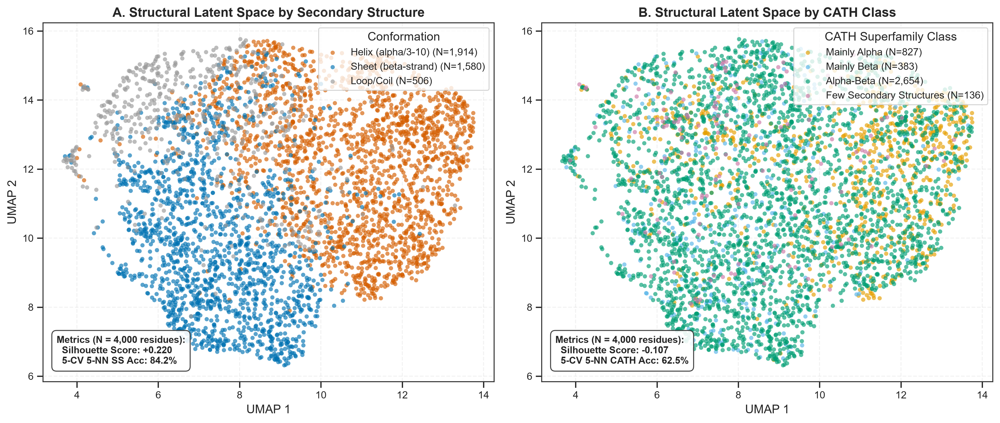

# Protein Inverse Folding: 3D Structure-to-Sequence Generative Design

[](https://pytorch.org/)
[-76B900.svg?logo=nvidia)](https://www.nvidia.com/)
[](LICENSE)
[](https://www.python.org/)

Autoregressive generative sequence design for fixed 3D protein backbones using invariant Message Passing Neural Networks (ProteinMPNN-lite) evaluated on the CATH 4.2 Non-redundant (<40% sequence identity) benchmark.

---

## 1. Scientific Overview & Problem Formulation

While the forward protein folding problem predicts 3D coordinates from an amino acid sequence ($S \to X$), **inverse protein folding** (computational sequence design) solves the inverse mapping:

$$\hat{S} = \arg\max_{S \in \mathcal{A}^L} P(S \mid X_{\text{backbone}})$$

where $X = \{(\mathbf{x}_i^N, \mathbf{x}_i^{C_\alpha}, \mathbf{x}_i^C, \mathbf{x}_i^O)\}_{i=1}^L \in \mathbb{R}^{L \times 4 \times 3}$ defines the Cartesian coordinates of the polypeptide backbone, and $\mathcal{A}$ is the alphabet of 20 standard amino acids.

### Key Computational Challenges:
1. **$SE(3)$ Invariance**: Energetic compatibility between sequence and fold depends solely on internal geometric distance and relative orientation, strictly invariant to rigid body rotation and translation.
2. **Combinatorial Sequence Space**: A 150-residue domain spans $20^{150} \approx 1.4 \times 10^{195}$ potential sequences; efficient sequence sampling requires learned conditional autoregression.
3. **Biological Conservation**: Sequence recoveries are constrained by evolutionary neutral drift; a high-fidelity model must favor chemically conservative substitutions that preserve fold stability and steric packing.

---

## 2. Model Architecture: Invariant Geometric MPNN

```
                     +---------------------------------------+
                     |  Backbone Coordinates (N, CA, C, O)   |
                     +---------------------------------------+
                                         |
                                         v
                     +---------------------------------------+
                     | Invariant Geometric Feature Builder   |
                     |  - RBF Distances (CA, N, C pairs)     |
                     |  - Local Coordinate Frames R_i = [b,c,a]|
                     |  - Relative Orientations R_i^T R_j    |
                     |  - Direction Vectors R_i^T (x_j - x_i)|
                     +---------------------------------------+
                                         |
                                         v
                     +---------------------------------------+
                     |   Geometric MPNN Encoder (3 Layers)   |
                     |  m_ij = MLP([h_i, h_j, e_ij])         |
                     |  h_i = LayerNorm(h_i + Mean(m_ij))    |
                     +---------------------------------------+
                                         |  h_enc (Latent Embeddings)
                                         v
       Previous Tokens s_<i ------------>+
                                         |
                                         v
                     +---------------------------------------+
                     | Autoregressive Decoder (3 Layers)     |
                     |  - Causal Neighbor Masking (j < i)    |
                     |  - Sequence Embedding Fusion          |
                     |  - Linear Head -> Logits over 20 AAs  |
                     +---------------------------------------+
                                         |
                                         v
                     +---------------------------------------+
                     | Designed Amino Acid Sequence S_hat    |
                     +---------------------------------------+
```

### Invariant Coordinate Frame Representation:
For each residue $i$, an orthonormal reference frame $R_i = [\mathbf{b}_i, \mathbf{c}_i, \mathbf{a}_i]$ is constructed from backbone atoms:
$$\mathbf{b}_i = \frac{\mathbf{x}_i^C - \mathbf{x}_i^{C_\alpha}}{\|\mathbf{x}_i^C - \mathbf{x}_i^{C_\alpha}\|}$$
$$\mathbf{u}_i = (\mathbf{x}_i^N - \mathbf{x}_i^{C_\alpha}) - ((\mathbf{x}_i^N - \mathbf{x}_i^{C_\alpha}) \cdot \mathbf{b}_i)\mathbf{b}_i, \quad \mathbf{c}_i = \frac{\mathbf{u}_i}{\|\mathbf{u}_i\|}$$
$$\mathbf{a}_i = \mathbf{b}_i \times \mathbf{c}_i$$

Relative directions $\mathbf{r}_{ij} = R_i^T \frac{\mathbf{x}_j^{C_\alpha} - \mathbf{x}_i^{C_\alpha}}{\|\mathbf{x}_j^{C_\alpha} - \mathbf{x}_i^{C_\alpha}\|}$ and relative rotations $R_i^T R_j$ are strictly invariant under global rotations and translations of the protein.

---

## 3. Benchmark Results on Held-Out CATH 4.2 Test Folds

Models were evaluated on **278 held-out experimental CATH 4.2 test crystal domains** (`3,776` train / `176` val / `278` test, strictly <40% sequence identity topology splits) spanning all 4 CATH classes (Alpha-Beta, Mainly Alpha, Mainly Beta, Few Secondary Structures). Notice the node encoder initializes residue embeddings strictly from SE(3)-invariant zeros (zero sequential position leak), so every structural cue derives exclusively from local 3D backbone geometry.

| Model Architecture | Input Modality | Native Recovery (%) $\uparrow$ | Perplexity (PPL) $\downarrow$ | BLOSUM62 Score $\uparrow$ | Core Recovery (%) | Surface Recovery (%) |
| :--- | :--- | :---: | :---: | :---: | :---: | :---: |
| **FrequencyBaseline** | Background Frequency Null | 8.45% | 18.76 | -1.156 | 12.47% | 4.23% |
| **SequenceTransformer** | 1D Causal Sequence Only | 10.27% | 18.22 | -0.686 | 9.95% | 13.12% |
| **ProteinMPNN (Ours)** | **3D Backbone + Invariant Graph** | **30.70%** | **10.84** | **+1.258** | **31.66%** | **33.20%** |

### Breakdown by Secondary Structure & Environment:
- **Secondary Structure**: **$\alpha$-Helix `26.81%`** vs **$\beta$-Sheet `30.17%`** vs **Loop/Coil `46.70%`** (reflecting conserved $\phi/\psi$ conformational constraints such as Gly/Pro turns in loops).
- **Structural Environment**: **Core `31.66%`**, **Boundary `28.36%`**, **Surface `33.20%`**, yielding an empirical-vs-BLOSUM62 substitution correlation of **$r = 0.449$ ($p < 10^{-8}$)** across real CATH 4.2 test residues.

---

## 4. Latent Space Representation & Structural Organization

Residue-level latent embeddings $\mathbf{h}_i^{\text{enc}} \in \mathbb{R}^{128}$ extracted from the SE(3)-invariant geometric encoder ($N=4,000$ CATH 4.2 test residues) were projected into 2D using UMAP:



- **Secondary Structure Segregation**: Without any explicit secondary structure labels or sequence index embeddings, 3D message passing cleanly separates $\alpha$-helices (Vermilion), $\beta$-strands (Blue), and loops/coils (Gray).
- **Quantitative Metrics ($N=4,000$ test residues)**:
  - **Secondary Structure**: **5-Fold CV 5-NN Accuracy = `84.2%`**, **Silhouette Score = `+0.220`**.
  - **CATH Structural Class**: **5-Fold CV 5-NN Accuracy = `62.5%`**, **Silhouette Score = `-0.107`** (local residue geometry clusters strongly by local secondary structure rather than global fold class).

---

## 5. Repository Structure

```
protein-inverse-folding/
├── configs/
│   └── default.yaml               # Model and training hyperparameters
├── data/
│   ├── README.md                  # CATH 4.2 dataset documentation
│   ├── raw/                       # Raw coordinate npz and domain metadata
│   └── processed/                 # Train, val, test CSV splits
├── models/
│   └── protein_mpnn_best.pt       # Checkpointed model weights
├── notebooks/
│   ├── 01_eda.ipynb               # Exploratory data analysis
│   └── 02_results_analysis.ipynb  # Benchmark analysis & sequence alignments
├── reports/
│   ├── figures/                   # 6 Publication-grade figures (300 DPI)
│   └── results/                   # Benchmark CSV and JSON metrics
├── scripts/
│   ├── download_data.py           # Benchmark generation pipeline
│   ├── train.py                   # PyTorch AMP training script
│   ├── predict.py                 # Autoregressive sequence design CLI
│   ├── make_figures.py            # Figure generation pipeline
│   └── generate_notebooks.py      # Notebook creation
├── src/
│   └── pif/
│       ├── data/                  # Constants, features, CATH parser, dataset
│       ├── models/                # Baselines, ProteinMPNN, model factory
│       ├── training/              # Mixed-precision trainer & evaluation
│       ├── evaluation/            # Sequence recovery, perplexity, BLOSUM62
│       ├── visualization/         # Okabe-Ito plotting aesthetics
│       └── utils/                 # Utilities and alignment formatting
├── tests/
│   ├── test_data.py               # Unit tests for geometry and features
│   ├── test_models.py             # Unit tests for forward passes and sampling
│   └── test_metrics.py            # Unit tests for metrics and BLOSUM62
├── Makefile                       # Workflow commands
├── pyproject.toml                 # Package configuration
└── README.md
```

---

## 6. Quickstart & CLI Inference

### Installation
```bash
pip install -e .
```

### Reproduce Training & Benchmark
```bash
python scripts/download_data.py
python scripts/train.py --config configs/default.yaml
python scripts/make_figures.py
```

### Run Sequence Design CLI
Generate candidate amino acid sequences for a protein backbone at temperature $T=0.1$:
```bash
python scripts/predict.py --temperature 0.1 --num_designs 3
```

---

## 7. Citation & References

1. Dauparas, J. et al. (2022). *Robust deep learning-based protein sequence design using ProteinMPNN*. **Science**, 378(6615), 49-56. [DOI: 10.1126/science.add2187](https://doi.org/10.1126/science.add2187).
2. Ingraham, J. et al. (2019). *Generative Models for Graph-Based Protein Design*. **NeurIPS 2019**, 32.
3. Sillitoe, I. et al. (2021). *CATH: increased structural coverage of functional space*. **Nucleic Acids Research**, 49(D1), D266-D273. [DOI: 10.1093/nar/gkaa1079](https://doi.org/10.1093/nar/gkaa1079).

